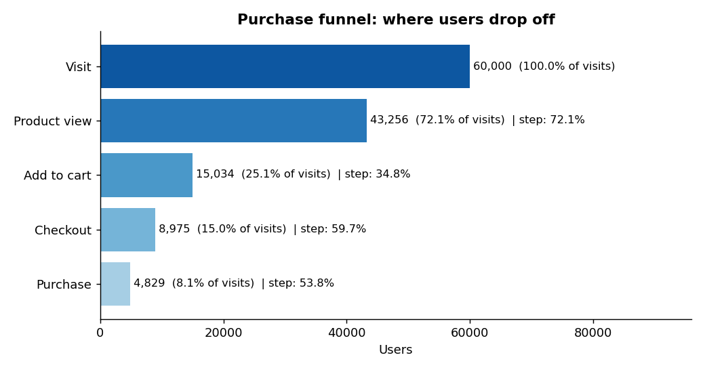
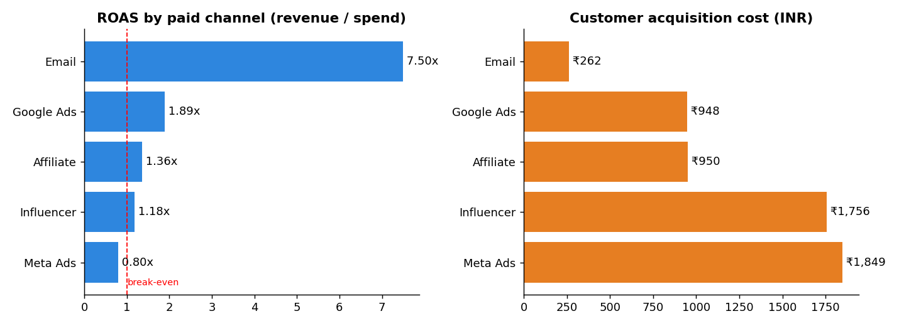
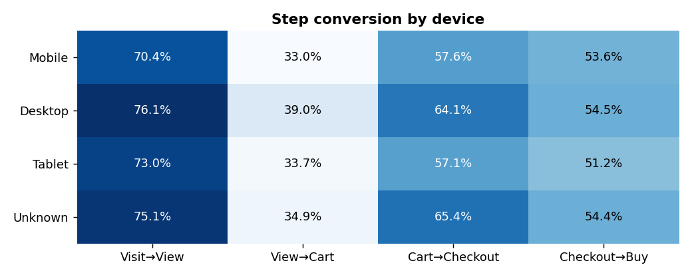
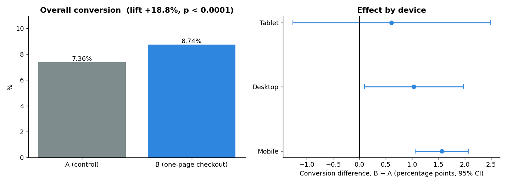

# Marketing Funnel & A/B Test Analytics (Python, SQL, Statistics)

An end-to-end analysis of a D2C e-commerce brand's **acquisition funnel, channel profitability, and a checkout-page A/B test** across 60,000 visitors (Jan–Jun 2026).

It answers three questions a marketing or product team actually asks:

1. **Where do users drop out of the purchase funnel, and on which devices?**
2. **Which paid channels pay back, and which burn money?**
3. **Should we ship the new one-page checkout?** (A/B test with proper statistics)

> **Data note:** the dataset is synthetic (seeded, reproducible) and generated by `src/generate_data.py`, because real marketing data is private. It deliberately includes messy records (duplicates, nulls, negative and extreme order values) so the cleaning step is real work. The numbers below are results on this simulated data, not claims about a real company.

## Key findings

| Area | Result |
|---|---|
| Funnel | 8.05% of visitors purchase. The biggest leaks: visit→cart (only 25% add to cart) and checkout→purchase (46% abandon at the last step) |
| Device gap | Desktop converts at 10.4% vs 7.2% on mobile, even though 68% of traffic is mobile |
| Channels | **Email: 7.5x ROAS** (₹262 CAC). **Meta Ads: 0.80x ROAS**, losing about ₹2.9 lakh over 6 months on first-order revenue |
| A/B test | One-page checkout lifted conversion **7.36% → 8.74%** (+18.8% relative, 95% CI for the difference +0.95 to +1.82 pp, p < 0.0001) |
| Revenue guardrail | Revenue per visitor rose ₹127.7 → ₹153.2 (bootstrap 95% CI ₹16.8 to ₹33.8), so the lift is not coming from cheaper orders |
| Segments | Effect is strongest on **mobile (+24%, significant after Bonferroni correction)**. Desktop (+10%) and tablet (+9%) are *not* significant after correction |

**Recommendation:** ship the new checkout (mobile first), reallocate part of the Meta budget toward Email and Google Ads, and run a follow-up test on desktop with a larger sample.

## Charts

| | |
|---|---|
|  |  |
|  |  |

## Methods

**SQL (SQLite):** CTEs, window functions (`ROW_NUMBER`, `LAG`, `FIRST_VALUE`, `RANK`, rolling `AVG`), conditional aggregation, views as a cleaning layer.

**Data cleaning** (`sql/01_clean_views.sql`): de-duplicated users and orders, removed negative and extreme order values (> ₹20,000), labelled missing device/city tier as `Unknown`. Every check is logged in `outputs/data_quality_report.csv`.

**A/B test design** (`src/analysis.py`):
- Sample ratio mismatch check (chi-square) to confirm the 50/50 split was not broken (p = 0.78)
- Two-proportion z-test with a confidence interval on the absolute difference
- Step metric (checkout→purchase) to confirm the change affects the stage it targets
- Revenue per visitor guardrail using Welch's t-test plus a bootstrap CI, since revenue is heavy-tailed
- Device segments with **Bonferroni correction** to avoid false positives from slicing
- Power analysis table: minimum sample size per arm for a given detectable lift

## Project structure

```
├── data/                  # generated CSVs (campaigns, users, funnel_events, orders)
├── sql/                   # 6 documented SQL files (cleaning, funnel, channels, segments, trend, A/B)
├── src/
│   ├── generate_data.py   # seeded synthetic data generator
│   └── analysis.py        # loads SQLite, runs SQL, stats tests, charts, report
├── outputs/               # result CSVs, key_findings.md, charts/
└── docs/resume_bullets.md
```

## How to run

```bash
pip install -r requirements.txt
python src/generate_data.py   # creates data/*.csv  (seeded, reproducible)
python src/analysis.py        # runs SQL + statistics, writes outputs/
```

## Limitations (what I would do next)

- ROAS here is based on **first-order revenue only**. Adding repeat purchases (LTV) would likely lift the paid channels; Meta's verdict could change.
- Attribution is last-touch by campaign; a multi-touch model would be more realistic.
- Next step: build a Power BI / Tableau dashboard on `outputs/*.csv`.

## Tech

Python (pandas, NumPy, SciPy, Matplotlib) · SQL (SQLite) · A/B testing · Funnel and channel analytics

# Marketing Funnel & A/B Test Analytics (Python, SQL, Statistics)
🔗 **Live Project Dashboard:** [Click Here to View Live App](https://marketing-funnel-ab-testing.onrender.com)
*(Note: Please allow 30–45 seconds for the free cloud server to spin up on the first load).*

